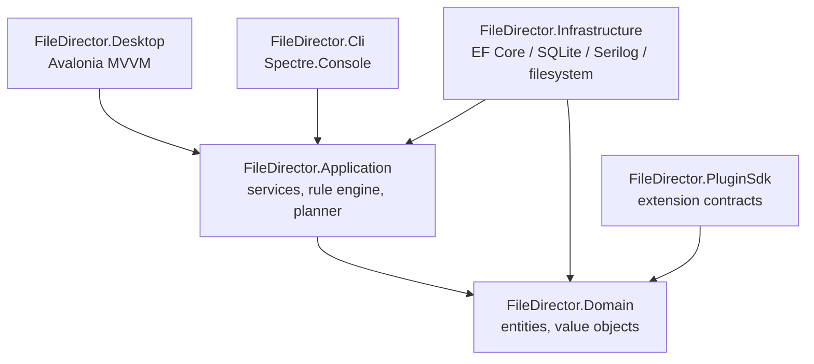
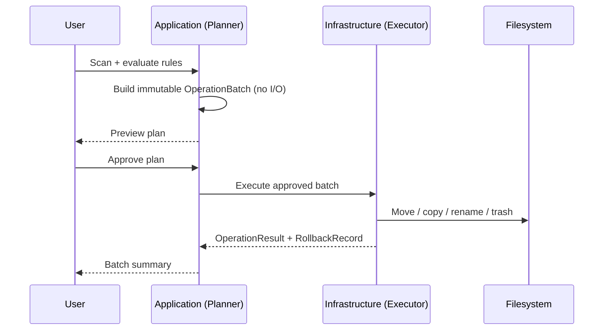

# Architecture

FileDirector is built as a modular clean architecture with a strict dependency direction:
outer layers depend on inner layers, never the reverse.

## Layers

**Domain** (`src/FileDirector.Domain`) — entities, value objects, and domain rules only.
No dependency on infrastructure, UI, database, or OS APIs. This is the one layer every other
project can safely depend on.

**Application** (`src/FileDirector.Application`) — application services and orchestration:
directory scanning, rule evaluation, operation planning, conflict detection, preview
generation, execution, rollback, duplicate detection, monitoring, configuration import/export.
Depends only on Domain. Defines the interfaces that Infrastructure implements.

**Infrastructure** (`src/FileDirector.Infrastructure`) — implementations of the interfaces
Application defines: SQLite persistence via EF Core, filesystem abstractions, hashing,
directory monitoring, YAML/JSON serialization, structured logging (Serilog), managed trash,
archive creation, and the system clock abstraction.

**Desktop** (`src/FileDirector.Desktop`) — Avalonia UI using MVVM. Views contain no business
logic; everything routes through Application services via view models.

**Cli** (`src/FileDirector.Cli`) — Spectre.Console command-line interface, the same
Application services as Desktop, for scripting and non-interactive/automated use.

**PluginSdk** (`src/FileDirector.PluginSdk`) — a minimal, versioned contract for future custom
rule conditions and actions. Contracts are defined and documented before any plugin-loading
mechanism exists — see [docs/plugin-development.md](docs/plugin-development.md) for the
current status and security boundaries.

## Why clean architecture here specifically

FileDirector moves and deletes real user files. Isolating the rule engine and operation
planner from the filesystem, the UI, and the database is what makes dry-run preview,
deterministic rule evaluation, and unit testing without touching disk possible. The planner
(Application layer) never performs I/O — it only produces an immutable plan. Execution
(Infrastructure layer) is a separate step the user explicitly approves.

## Planning vs. execution

This split is the core safety mechanism, not an implementation detail:

No filesystem changes happen before the user has seen and approved the plan. See
[docs/filesystem-safety.md](docs/filesystem-safety.md) for the full safety model.

## Current status

This repository is in **Phase 1 — Repository Foundation**: solution structure, shared build
configuration, package management, logging foundation, empty test projects, and CI are in
place. The Domain model, rule engine, and operation planner described above are not yet
implemented — see [ROADMAP.md](ROADMAP.md).

## Architecture decisions

Significant decisions are recorded under [docs/adr/](docs/adr/) as they are made.
