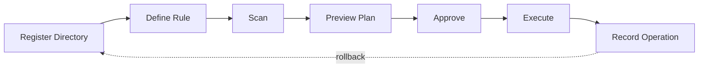

# FileDirector

**Configurable File Organization and Automation Utility**

FileDirector is a cross-platform desktop and CLI application for organizing, classifying,
renaming, deduplicating, archiving, monitoring, and safely relocating files through
user-defined automation rules. It is built as a maintainable software product — not a
one-off sorting script — with a reusable rule engine, safe operation planning, dry-run
previews, persistent history, and rollback support at its core.

## Status: pre-alpha (foundation phase)

This repository currently contains **Phase 1 — Repository Foundation** only: the solution
structure, build configuration, logging foundation, empty test projects, and CI/CD workflows.
The rule engine, operation planner, and safe execution described below are not implemented
yet. See [ROADMAP.md](ROADMAP.md) for the phased plan and current progress.

## Why FileDirector

Downloads folders, screenshot directories, and project workspaces accumulate clutter that
ad-hoc scripts handle unsafely — silent overwrites, permanent deletions, no way to undo a
mistake. FileDirector treats file organization as something that deserves the same rigor as
any other software: previewable plans, reversible operations, and a rule engine you can
reason about.

## Features (target, see Roadmap for what's built)

- Register one or more managed directories
- Define reusable, composable file-organization rules (conditions + actions, AND/OR groups,
  priorities, dry-run)
- Scan directories manually or via configurable monitoring
- Preview proposed operations before anything touches disk
- Approve and execute planned operations, with full operation history
- Rename files using templates (`{year}-{month}-{day}_{original-name}_{counter}.{extension}`)
- Detect duplicate files via staged hashing (size → partial hash → full SHA-256)
- Archive files by age or rule
- Undo supported operations via recorded rollback metadata
- Import/export configuration as JSON or YAML
- Both a desktop UI (Avalonia) and a scriptable CLI (Spectre.Console)

## Architecture overview

Clean architecture with a strict inward dependency direction — Domain has no dependency on
anything else; Application depends only on Domain; Infrastructure, Desktop, and Cli depend on
Application and Domain. See [ARCHITECTURE.md](ARCHITECTURE.md) for the full diagram and
rationale, including why planning and execution are deliberately separate steps.



## Installation

Requires the [.NET 9 SDK](https://dotnet.microsoft.com/download) (or later) to build from
source. Packaged releases (Windows/Linux/macOS) will be published once Phase 12 is complete —
see [docs/release-process.md](docs/release-process.md).

```bash
git clone https://github.com/APonder-Dev/FileDirector.git
cd FileDirector
dotnet build
```

## Desktop usage

```bash
dotnet run --project src/FileDirector.Desktop
```

The desktop app is currently the unmodified Avalonia MVVM scaffold — dashboard, directory
management, rule editor, and other pages land in Phase 8.

## CLI usage

```bash
dotnet run --project src/FileDirector.Cli
```

Command set (`scan`, `preview`, `apply`, `duplicates`, `rules`, `history`, `rollback`,
`monitor`, `health`) is implemented starting in Phase 7. Today the CLI only bootstraps
logging and prints a startup banner.

## Configuration

FileDirector will support JSON and YAML rule configuration, validated before execution, with
example configurations for common scenarios (Downloads organization, photo library sorting,
document categorization, log archival, duplicate detection, etc.) under `docs/examples/` and
`samples/`. See [docs/configuration.md](docs/configuration.md).

## Safety model

Filesystem safety is a primary product requirement, not an afterthought:

- **Planning never touches disk.** Scans and rule evaluation produce an immutable plan you
  review before anything executes.
- **Nothing is permanently deleted by default.** Deletions go to a managed application trash.
- **Protected OS directories stay protected** unless an advanced override is explicitly
  enabled.
- **Every executed batch is recorded** with rollback metadata.

Full details: [docs/filesystem-safety.md](docs/filesystem-safety.md).

## Development setup

```bash
dotnet restore
dotnet build
dotnet test
dotnet format --verify-no-changes
```

See [CONTRIBUTING.md](CONTRIBUTING.md) for branch naming, commit conventions, and the PR
checklist.

## Testing

Unit, application-service, infrastructure, database-integration, filesystem-integration, CLI,
and rule-engine tests live under `tests/`. All filesystem-touching tests use isolated
temporary directories — the real user profile and repository are never modified by a test
run.

```bash
dotnet test
```

## Release process

Semantic versioning; `v1.0.0` is not tagged until the core safety model, rollback behavior,
and test suite are stable. See [docs/release-process.md](docs/release-process.md).

## Roadmap

See [ROADMAP.md](ROADMAP.md) for the full 12-phase plan and current status.

## License

[MIT](LICENSE) © Anthony Ponder
